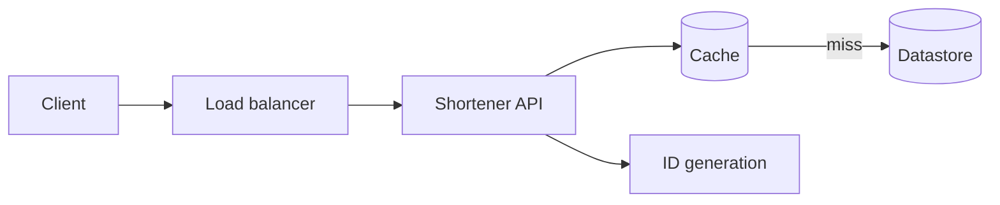

# Architecture

Draw it first on paper. Then transcribe here as a mermaid diagram.

## Components

| Component | Job | Why this and not the alternative |
|---|---|---|
| | | |

## Request paths

**Write (shorten a URL):**

**Read (follow a short link):**
